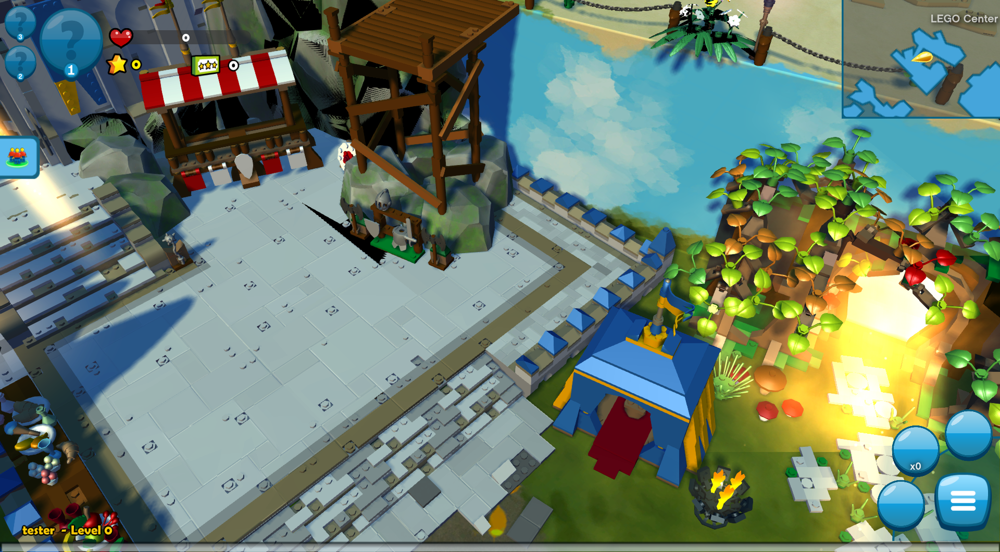

# LMOxide

A server for the LEGO Minifigures Online client (Funcom, shut down in 2016), written in Rust.
LMO runs on Funcom's Dreamworld/N3 engine; everything here was reverse-engineered from the
shipped client (see [docs/PROTOCOL.md](docs/PROTOCOL.md)).



**Status:** login with real accounts, the starting worlds and all dungeons with enemies, combat,
the minifigure collection and team, loot, friends, teams and multiplayer work; see
[docs/TUNABLES.md](docs/TUNABLES.md) for what is guessed.

## What's in the repository

Everything except the (copyrighted) game clients.

| Path | |
|---|---|
| `crates/lmoxide-server` | the game server: universe agent, territory manager, game and chat servers, and an internal control interface; admin subcommands (`account ...`, `login-key`) |
| `crates/lmoxide-api` | REST API for administration and status (web UI, Discord bot): [docs/API.md](docs/API.md) |
| `crates/lmoxide-patch-server` | the HTTP the client needs (configuration, patching, login page, chat filter) and the LMOxide patcher protocol: [docs/PATCHING.md](docs/PATCHING.md) |
| `crates/lmoxide-patch`, `crates/lmoxide-patcher` | patcher library (for a GUI) and command-line patcher |
| `crates/lmoxide-db` | storage (SQLite): accounts, characters, friendships, API keys, audit log |
| `crates/lmoxide-control` | the control interface between the API and the game server |
| `crates/lmoxide-net` | the client's wire protocol and login encryption |
| `patches/` | client patches for hand-installed clients: `patch-client.py`, the native Linux client kit |
| `data/`, `proto/` | game data and protobuf schemas extracted from the client |
| `tools/` | development and reverse-engineering scripts |
| `docs/` | protocol notes, tunables, [security](docs/SECURITY.md), API, patching |

**About `data/` and `proto/`:** these were extracted from the shipped client (game data such as
spawns, loot and stats; protobuf schemas and RPC method signatures from `LMO.exe`) and are kept
in the repository because the server is built from them. They are included for interoperability
with the client, which can't be played without a server since Funcom shut theirs down. The
`tools/re/extract_*.py` scripts regenerate them from a client. No client files themselves are
included: bring your own copy.

The web UI and the Discord bot live in their own repositories and talk to `lmoxide-api`
([docs/WEB-UI.md](docs/WEB-UI.md), [docs/DISCORD-BOT.md](docs/DISCORD-BOT.md), contract:
[docs/openapi.json](docs/openapi.json); `tools/web-dev-backend.sh` runs a local API with demo
accounts and bot keys).

## How it fits together

```
 game client ──TCP 7100-7102, 7200──▶ lmoxide-server ◀──control 7300 (private)── lmoxide-api ◀── web UI, bots
      │                                     │  SQLite (lmoxide.db)    ───────────┘   HTTPS 8090
      └──HTTP 8080──▶ lmoxide-patch-server ◀┘  login-public-key.txt
 LMOxide patcher ──────────┘ (signed manifests)
```

Passwords travel encrypted with the client's Diffie-Hellman/TEA scheme against this server's own
login key, which the patch server writes into the client binaries it serves. Game traffic itself
can't be encrypted (client limitation): [docs/SECURITY.md](docs/SECURITY.md).

## Running with Docker

```sh
cp docker/.env.example .env            # set LMOXIDE_PUBLIC_HOST, client paths
mkdir -p secrets && openssl rand -hex 32 > secrets/control_token
docker compose up -d --build
docker compose exec server lmoxide-server account create <you> --gm-level 2
docker compose exec api lmoxide-api key create discord-bot --scope read
```

The compose file runs the game server, the API and the patch server from one image, with the
database in the `data` volume. Players install the client with the patcher
(`lmoxide-patcher install --server http://<host>:8080 --dir ~/Games/LMO`).

## Running from source

Needs Rust, `protoc`, and an extracted client at `../clients/windows/LEGO Minifigures Online`
(the scripts' default; `../clients/linux/...` for the native Linux client).

```sh
# accounts (or --auto-register: the first login creates the account)
cargo run -p lmoxide-server -- account create <name> --gm-level 2

tools/lan-server.sh --release            # LAN play: game server + patch server on this PC's address
LMO_AUTOPLAY=1 tools/test-run.sh 60      # development: server + Wine client, summary, screenshot
```

Progression is off by default (every character at level 30 with every minifigure fully
ranked). `--progression` (or `LMOXIDE_PROGRESSION=1`) starts characters at level 1, gives XP
for defeated enemies and lets players rank minifigures up with stars; see docs/TUNABLES.md.

Ports (all configurable, `--help`): patch server 8080, universe 7100, territory 7101, game 7102,
chat 7200, control 7300 (private), API 8090.

## Test commands

Typed into the normal chat in game (free text needs a GM level; `tools/lan-server.sh` sets 1).
A line starting with `!` (or `/`, if the client lets it through) goes to the server, not to other
players, in the local chat or any channel tab (e.g. Global); answers come back as local chat lines
from "Server" (`crates/lmoxide-server/src/devcmd.rs`).

| Command | Does |
|---|---|
| `!where` | current playfield and position |
| `!tp <playfield or name>` | go to a playfield's arrival point (`!tp 5200`, `!tp kingdom`) |
| `!list <kind>` | numbered test targets of a kind: `buildie`, `pad`, `lever`, `plate`, `gate`, `mirror`, `collectible`, `boombox`, `trigger`, `arena`, `ambush`, `explore`, `boss`, `champion`, `enemy`, `npc`, `fighter`, `smashable` |
| `!goto <kind> [n]` | go next to target n (default 1), e.g. `!goto buildie 2` |
| `!dialog [n]` | play recorded NPC dialogue n (without n: list them); `!aura <0-4>` sets the active minifigure's aura tier |
| `!plates <solve\|reset>` | light every plate of the Gauntlet's plate room (`!test plates`), or none |
| `!mirrors <solve\|reset>` | turn this playfield's Medusa mirrors (Armory, Gauntlet) to the solution or back to the start (`!test mirrors`, `!test mirrors2` go there) |
| `!test [n\|label]` | list the manual test setups, or set one up: go somewhere, switch the team, spawn enemies around you for 15 minutes (`data/test_scenarios.json`; add your own there) |
| `!smash` | smash the nearest smashable (or defeat the nearest enemy) within 15 m |
| `!sleep <secs>` | in `LMOXIDE_DEV_COMMANDS` only: wait before the next command |
| `!ach` | achievements earned, kill and smash counters, most defeated enemies, playfields visited, finds |
| `!count <kills\|smashes\|builds> [n] [name]` | count n defeats, smashes or builds for achievements (e.g. `!count kills 1000`, `!count kills 50 Witch`) |
| `!xp [n]` | gain n XP (with `--progression`) and show level and XP |
| `!stars <n>` | gain n stars (to rank minifigures up with `--progression`) |
| `!defeat <boss name>` | count a boss defeat (`!defeat Hades`) for the boss and the active minifigure's achievements |

New features add their targets to `devcmd.rs` `targets`.

## Tools

| Command | What it does |
|---|---|
| `tools/test-run.sh [secs]` | restart the servers + client (auto-login as `tester` / `tester-password`), wait, print a summary of RPCs, warnings and client progress, screenshot the game window to `logs/screen.png`; `LMO_AUTOPLAY=1` also presses "start" via Lua |
| `LMOXIDE_DEV_COMMANDS="!test crowd;!xp 10"` (server env) | run test commands 5 s after the first entry into the world, as if typed (scripted test runs) |
| `tools/tour.sh <kind> [secs] [dir]` | screenshot tour: the server (`LMOXIDE_DEV_TOUR`) teleports the test character to each target of a test-command kind (`boss`, `buildie`, ...) and the script screenshots each one into `logs/tour-<kind>/` with `labels.txt` |
| `tools/keep-listening.py --ports P,.. -- CMD` | keeps the game server's ports listening across restarts (inherited by lmoxide-server via `LMOXIDE_LISTEN_FDS`) and starts the server again when it exits: a client pressing "relocate? Yes" during a restart waits instead of failing. `lan-server.sh` uses it (`tools/lan-server.sh --restart [--release]` rebuilds and restarts only the game server); `LMOXIDE_KEEP_LISTENING=1` for dev-run |
| `tools/dev-run.sh <client-dir> <log-dir>` | restart game server, patch server and client (patched with the login key by `patches/patch-client.py`) and leave them running; `LMO_RUNNER=wine\|proton\|linux` picks how the client runs (`linux` = native build, `<client-dir>` is then the Linux client) |
| `tools/client-mouse.sh click\|scroll\|drag\|info ...` | click/scroll/drag at window-local coordinates in the LMO client (or any window via `LMO_WINDOW=class:RE\|title:RE`) on a hidden workspace, without moving the real cursor or focus, through a Hyprland plugin it builds and loads on demand (`tools/hypr-target-pointer/`) |
| `tools/proton-run.sh /abs/LMO.exe [args]` | run the Windows client under Steam's Proton without Steam (prefix `~/.local/share/lmo-proton`) |
| `lmoxide-patcher install --server http://host:8080 --dir d` | install or update a client from a patch server (signed manifests; `verify`, `info`): docs/PATCHING.md |
| `examples/login_probe` (`cargo run -p lmoxide-net --example login_probe -- host:7100 user pass key`) | log in like the client, without starting the game |
| `patches/linux-client/install.sh [--server ip] [--dir d]` | install the native Linux client (download, verify, extract, apply the kit); `~/Games/LMO/lmo <username>` starts it. See `patches/linux-client/README.md` |
| `patches/linux-client/apply.sh <dir> [--server ip]` | the client patch kit: apply (again) to an extracted client |
| `patches/linux-client/make-kit.sh` | pack the kit (prebuilt libraries) as `dist/lmo-client-kit-v<N>.tar.gz` for another PC |
| `patches/linux-client/play.sh <dir> <server-ip> <username>` | start a kit-installed client from another folder |
| `tools/lan-server.sh [--release] [lan-ip]` | game server + patch server (Windows and, from `clients/downloads/LMO_Linux_v1.5.557666.zip`, Linux installs) + REST API on :8090 for LAN play (binds 0.0.0.0, advertises the LAN IP; `--auto-register`, GM level 1); logs in `logs/lan-*.log` |
| `tools/lan-party.sh [--reset] [lan-ip]` | `lan-server.sh --release` with open registration + the web UI (`../lmoxide-webui` built, served on :4173); accounts `host`, `player1`..`player8` with password `password` and GM level 2 (admin); `--reset` deletes every character but host's |
| `tools/re/py method.py <name\|0xID\|Iface::>` | RPC lookup: ID, signature, client dispatch/sender function, argument read order |
| `tools/re/py xref.py <regex>` | search exe strings, with referencing functions |
| `tools/re/py d.py <va> [bytes]` | disassemble with string annotations |
| `tools/re/py extract_rpc.py <out.json>` | regenerate `data/rpc_methods.json` |
| `tools/re/py extract_protos.py <exe> <dir>` | regenerate `proto/` |
| `tools/ghidra/analyze.sh` | one-time Ghidra import + analysis into `../research/ghidra/` |
| `tools/ghidra/decompile.sh <va...>` | decompiled C of the functions containing each address |
| `tools/ghidra/xrefs.sh <va...>` | references to each address (code and data, one level through vtables) |
| `tools/ghidra/symbols.sh <regex> [n]` | symbols matching a regex; for vtables, the first n slots |
| `tools/re/py extract_iir.py <out.json>` | regenerate `data/iir_types.json` (IIR names, type ids, classes, protobufs) |
| `tools/re/py extract_progression.py` | regenerate `data/progression.json` (minifigure rank costs, rank level requirements) |
| `tools/re/py extract_achievements.py` | regenerate `data/achievements.json` (the lore tree's achievements, with inferred rules) |
| `tools/re/py extract_encounters.py` | regenerate `data/encounters.json` (boss arenas, ambushes, champion spots from the bounded areas, RDB 1000053 of the Linux client) |
| `tools/re/py extract_spell_actions.py` | regenerate `data/spell_actions.json` (action lists of the channelled abilities and the nanos they cast) |
| `tools/re/py gameactions.py SPELL...` | a spell's game action lists |
| `tools/re/py extract_return_points.py` | regenerate `data/return_points.json` (arrival next to the portal back to where the player came from) |

Setup for the Python tools: `python3 -m venv .venv && .venv/bin/pip install pefile capstone protobuf`.
They read `../clients/windows/LEGO Minifigures Online/LMO.exe` by default, or `$LMO_EXE`. Ghidra comes
from `/opt/ghidra` (Arch `ghidra` package) or `$GHIDRA_HOME`.
